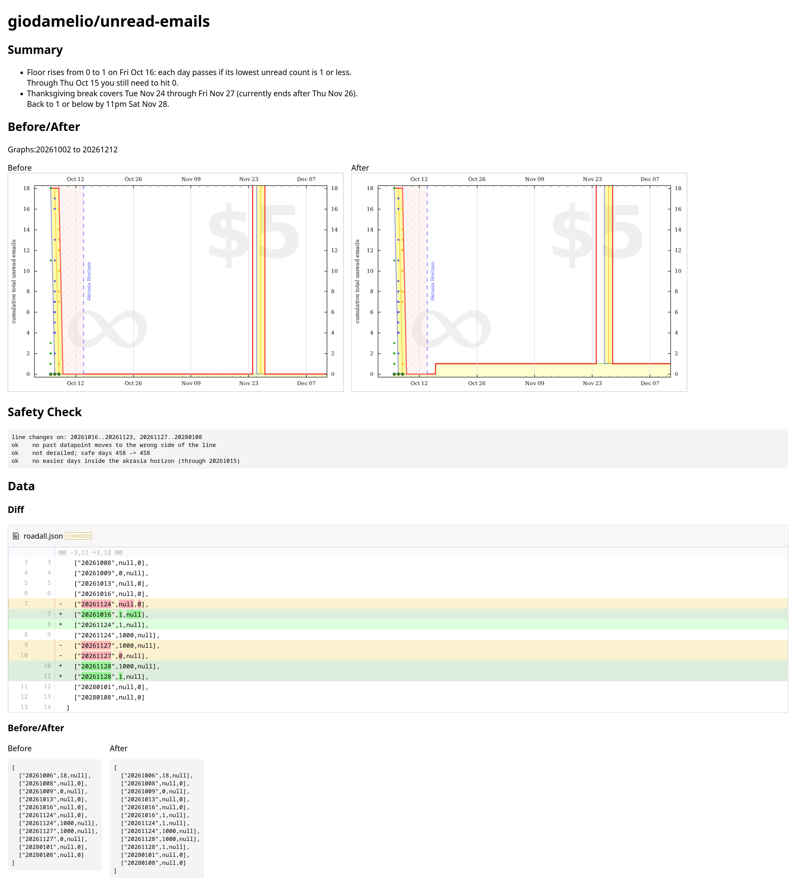

# beeminder-api-experiments

Tools for editing a [Beeminder](https://www.beeminder.com) goal's bright red line through the API instead of the web graph editor.

## Setup

Dependencies to run

- [Bun](https://bun.sh)
- Chromium, available on your `PATH` as `chromium`. It renders the before and after graphs.

Then install the JavaScript dependencies:

```
bun install
```

Set `BEEMINDER_API_TOKEN` to your personal auth token. While logged in to Beeminder, get it from [your auth token page](https://www.beeminder.com/api/v1/auth_token.json).


### Use devenv and Nix

If you use [devenv](https://devenv.sh), enter it instead of installing the dependencies by hand. It provides Bun, Chromium, Hurl and fonts, and sets the Hurl variables. It loads `BEEMINDER_API_TOKEN` from your system keyring through [SecretSpec](https://secretspec.dev). To store the token there the first time, run `secretspec check`, which asks for any secret that is missing. You still need to run `bun install`.


## Edit a graph

Ask Claude Code to change a goal's graph, for example "give unread-emails a break from Dec 24 to Dec 26". The `beeminder-graph` skill in `.claude/skills/beeminder-graph/` fetches the goal, makes the edit, checks it, renders before and after graphs for you to review, and only sends the change after you approve it.

Before anything is sent, the skill writes a preview of the change to `graphs/<goal>/<timestamp>/index.html`. It shows a summary of the change, the before and after graphs side by side, the safety check results, and a diff of the line's data. The contents of `graphs/` are not committed.



## Credit the bundled Beeminder code

`.claude/skills/beeminder-graph/vendor/road/` contains files copied unmodified from [beeminder/road](https://github.com/beeminder/road) at commit `a271687e6f086fa6b63cef6bdc20d9195a29f5f4`. They are Beeminder's own graph engine (Beebrain) and graph renderer, so the checks and previews here match what beeminder.com shows.

Thanks to all the creators and contributes for making it open source so I can mess with it!

The licenses, as stated in that repository:

- `beebrain.js`, `bgraph.js`, `broad.js`, `butil.js`, `jsbrain.css`: copyright Uluc Saranli and Daniel Reeves. The repository's `package.json` declares the MIT license. The repository has no separate LICENSE file.
- `d3.v7.min.js`: [D3](https://d3js.org) v7.9.0, copyright Mike Bostock, ISC license.
- `moment.js`: [Moment.js](https://momentjs.com) 2.29.1, MIT license.
- `fili.js`: [Fili](https://github.com/markert/fili.js) 2.0.3 by Florian Markert, MIT license.
- `polyfit.js`: distributed in beeminder/road without a license header.
